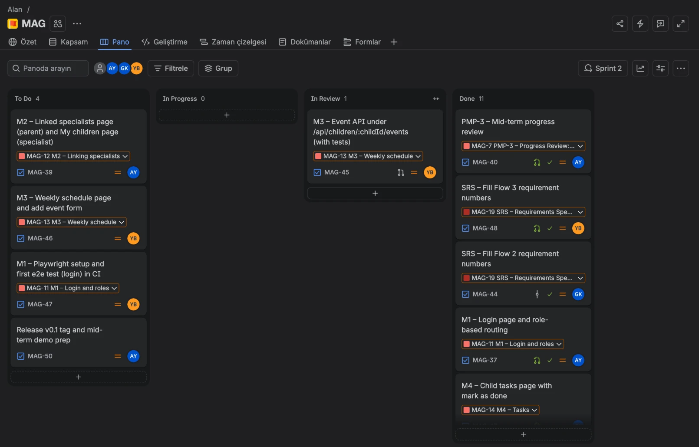

# Project Management Plan (PMP)

> The purpose of this PMP is to practice planning and tracking work in Jira. Keep it short: most of the content is a summary of what you set up in Jira.
> Keep this file at `docs/PMP.md`. Each section is one Jira epic (PMP-1 … PMP-6); mark the epic Done when the section is complete.
> Save screenshots in `docs/img/`.

| Section | Content | Required by |
|---|---|---|
| PMP-1 | Project, Jira setup, team and roles | Week 6 |
| PMP-2 | Work packages (epics) and sprint plan | Week 6 |
| PMP-3 | Progress review: mid-term (v0.1) | Mid-term evaluation (Week 8 / 9) |
| PMP-4 | Progress review: v0.2 | Week 10 |
| PMP-5 | Progress review: final (v1.0) | Final evaluation |
| PMP-6 | Retrospective | Final evaluation |

---

## PMP-1. Project and Team

### Project and Jira Setup

**Project in one sentence:** A web-based decision support platform that brings parents and specialists together around one shared weekly schedule, task list and record of observations for a child, with a role-based AI summary that supports decisions but never makes them.  
**Jira project key:** MAG  
**Jira board link:** https://seng383-mag.atlassian.net/jira/software/projects/MAG/boards/1  

Jira is connected to the team repository (https://github.com/Atakan109/seng383-mag) with the GitHub for Atlassian app. Every branch name and commit message starts with its Jira issue key (e.g., `MAG-20 Add PMP template`).

### Team and Roles

| Name | Jira / GitHub username | Role |
|---|---|---|
| Atakan Yurdasucu | Atakan Yurdasucu / Atakan109 | Project Manager, Developer (M1, M2) |
| Gökhan Kara | Gökhan Kara / gokhankaraa | Developer (M4, M6, M8) |
| Yasin Mirza Bozkurt | Yasin Mirza Bozkurt / ymirzabzkrt | Developer, Tester (M3, M5, M7) |

---

## PMP-2. Plan

### Work Packages (Epics)

> Number of tasks: tasks under the epic in Jira on the date of this section. Module tasks for Sprint 2 and 3 are created at the start of each sprint.

| Epic | Owner | Number of tasks | Planned sprint(s) |
|---|---|---|---|
| M1 – Login and roles | Atakan Yurdasucu | 0 | Sprint 2 |
| M2 – Linking specialists | Atakan Yurdasucu | 0 | Sprint 2 |
| M3 – Weekly schedule | Yasin Mirza Bozkurt | 0 | Sprint 2 |
| M4 – Tasks | Gökhan Kara | 3 (walking skeleton) | Sprint 1, Sprint 2 |
| M5 – Specialist entries | Yasin Mirza Bozkurt | 0 | Sprint 3 |
| M6 – Documents | Gökhan Kara | 0 | Sprint 3 |
| M7 – Weekly statistics | Yasin Mirza Bozkurt | 0 | Sprint 3 |
| M8 – Role-based AI summary | Gökhan Kara | 0 | Sprint 3 |

Documentation epics: PMP-1 … PMP-6 (Atakan), SRS and DESIGN (each member writes the sections of their own modules).

### Sprint Plan

| Sprint | Weeks | Sprint goal | Ends with |
|---|---|---|---|
| Sprint 1 | Weeks 4–6 (24 Oct – 8 Nov) | Repository, Jira and CI set up; SRS and SDD first version; walking skeleton (SQLite → Express → React) | Walking skeleton (v0.0), Week 6 |
| Sprint 2 | Weeks 7–9 (9 – 29 Nov) | M1–M4 working end to end with tests; first end-to-end test running in CI | Release v0.1, mid-term (Week 9, Section 2) |
| Sprint 3 | Week 10 (30 Nov – 6 Dec) | M5–M8; end-to-end tests for the 3 critical flows; branch coverage ≥ 40%; SRS and SDD final | Release v0.2, Week 10 |
| Sprint 4 | Weeks 11–12 (7 – 20 Dec) | An end-to-end test for each of M1–M8; branch coverage ≥ 60%; final report and demo | Release v1.0, final (Week 12) |

---

## PMP-3. Progress Review: Mid-term (v0.1)

**Review date:** 23 November 2026 (Sprint 2, third of three weeks). This section is updated again when v0.1 is released.

**Jira board screenshot (Sprint 2, 23 Nov):**

| Epic | Planned for this point | Status (Done / In progress / Not started) |
|---|---|---|
| M1 – Login and roles | Users table, login API (JWT), login page, first e2e test | **In progress** – users table (MAG-35), login API (MAG-36) and login page with a home page per role (MAG-37) done; e2e test (MAG-47) not started |
| M2 – Linking specialists | Link API with the childAccess check, parent and specialist pages | **In progress** – link API and childAccess done (MAG-38); pages not started (MAG-39) |
| M3 – Weekly schedule | Event API and weekly schedule page | **In progress** – event API in review (MAG-45); schedule page not started (MAG-46) |
| M4 – Tasks | Task API under `/api/children/:childId/tasks`, assign and child pages | **Done** – task API (MAG-41), assign task form and assigned tasks page (MAG-42), child tasks page with mark as done (MAG-43) |
| SRS | First version; requirement numbers for the critical flows | **Done** for this point – first version merged, Flow 2 (MAG-44) and Flow 3 (MAG-48) numbers added |
| DESIGN | First version; UI sketches for M3, M5, M7 | **Done** for this point – first version merged, sketches added (MAG-49); image link to be fixed |
| PMP-1, PMP-2, PMP-3 | Project, team, plan and mid-term review | **Done** |

**Sprint 2 progress:** 11 of 16 tasks done, 1 in review (MAG-45), 4 to do (MAG-39, MAG-46, MAG-47, MAG-50).

**Changes to the plan:**
- Sprint 2 started with planning and documentation: closing Sprint 1, creating the Sprint 2 tasks in Jira (12 Nov) and finishing the remaining SRS and SDD tasks. Coding started on 15 Nov with the users table (MAG-35).
- Login (MAG-35, MAG-36) is needed by every role-based page, so it was done first. The M3 and M4 APIs were built in parallel on top of it and use the same childAccess check.
- The task pages (MAG-42, MAG-43) are merged but not yet opened from the home page after login; this is connected together with the M2 pages (MAG-39).

---

## PMP-4. Progress Review: v0.2

**Jira board screenshot:**  

| Epic | Planned for this point | Status (Done / In progress / Not started) |
|---|---|---|
| | | |
| | | |

**Changes to the plan (if any):**

---

## PMP-5. Progress Review: Final (v1.0)

**Jira board screenshot:**  

| Epic | Planned for this point | Status (Done / In progress / Not started) |
|---|---|---|
| | | |
| | | |

**Changes to the plan (if any):**

---

## PMP-6. Retrospective

- What worked well in using Jira:
- What we would do differently:
