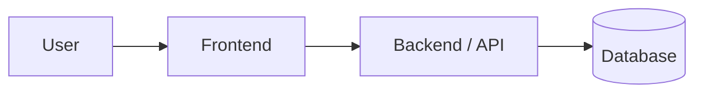
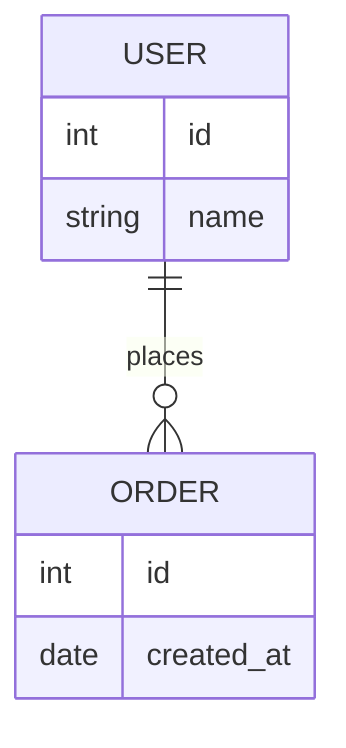
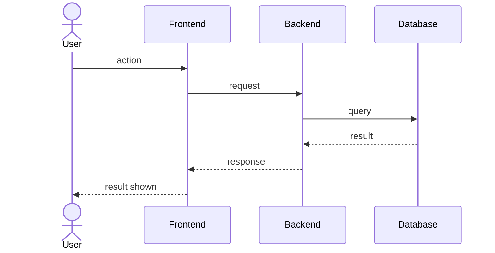

# Software Design Document (SDD)

**Team name:**  
**Version:** ☐ First version (Week 6) ☐ Final (Week 10)  
**Last updated:** YYYY-MM-DD

> Keep this file at `docs/SDD.md`. Describe how the system is built; the SRS describes what it does.
> Diagrams can be written in Mermaid (renders directly on GitHub) or added as images from `docs/img/`.
> Delete the guidance notes (lines starting with `>`) when you fill in a section.

---

## 1. Architecture Overview

> Describe the overall structure in 2–3 sentences (e.g., client–server, layered, frontend + REST API + database) and add one diagram.

### Technology Stack

| Layer | Technology |
|---|---|
| Frontend | |
| Backend | |
| Database | |
| Testing | |
| CI | GitHub Actions |

---

## 2. Module Design

> One row per module (M1–M8, same as your SRS and Jira epics). Name the main components (classes, services, pages) that implement each module.

| Module | Main components | Implements requirements |
|---|---|---|
| M1 | | FR-M1-01, … |
| M2 | | |
| M3 | | |
| M4 | | |
| M5 | | |
| M6 | | |
| M7 | | |
| M8 | | |

---

## 3. Data Model

> Main entities and their relationships. A simple ER diagram is enough.

---

## 4. API / Interfaces

> List the main endpoints or interfaces between components. Skip this section if your system has no API.

| Method | Endpoint | Description | Module |
|---|---|---|---|
| GET | | | |
| POST | | | |

---

## 5. Critical Flows

> Use the same 3 critical flows as SRS Section 4. Add one sequence diagram for each.

### Flow 1:

### Flow 2:

### Flow 3:

---

## 6. User Interface

> Add sketches or screenshots of the main screens (hand-drawn wireframes are fine).

| Screen | Image | Module |
|---|---|---|
| | `docs/img/…` | |

---

## 7. Change Log

| Date | Change | By |
|---|---|---|
| | First version | |
