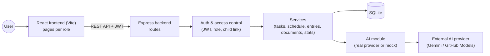
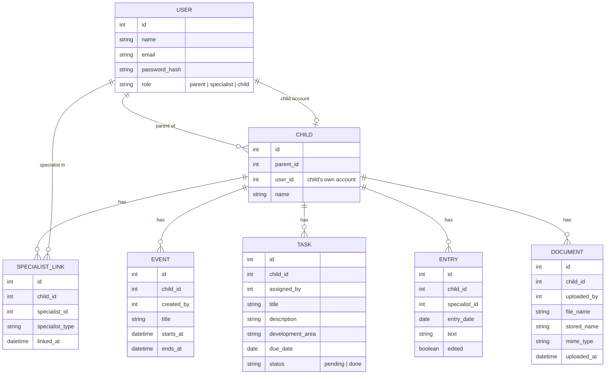
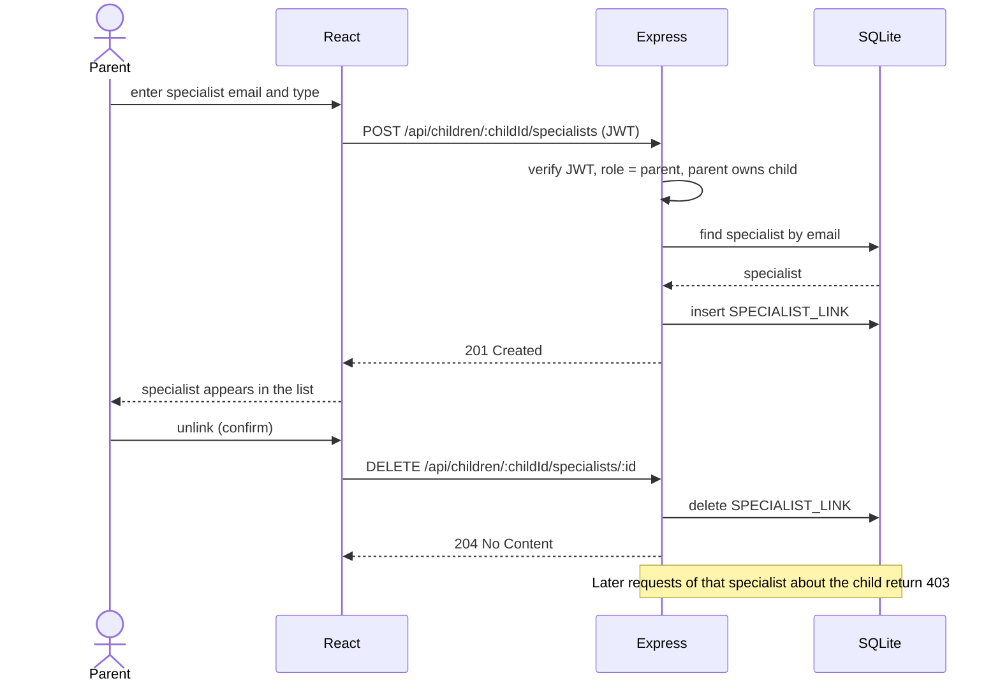
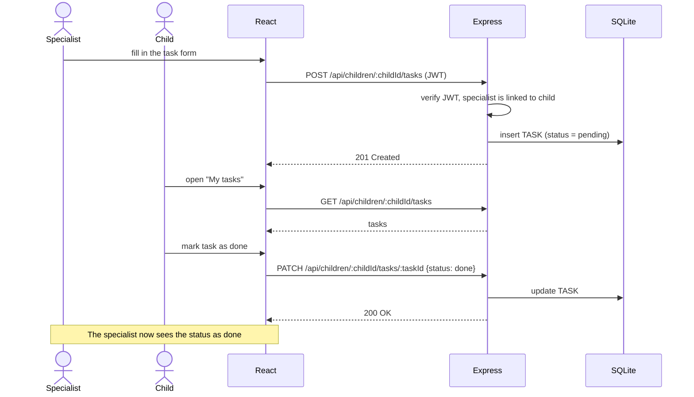
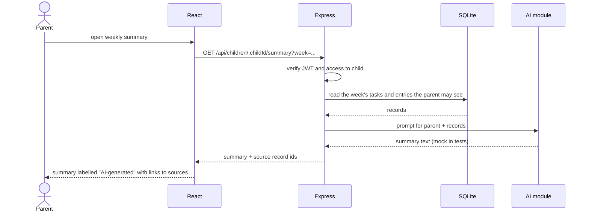

# Software Design Document (SDD)

**Team name:** MAG  
**Version:** ☒ First version (Week 6) ☐ Final (Week 10)  
**Last updated:** 2026-10-27

> Keep this file at `docs/SDD.md`. Describe how the system is built; the SRS describes what it does.
> Diagrams can be written in Mermaid (renders directly on GitHub) or added as images from `docs/img/`.
> Delete the guidance notes (lines starting with `>`) when you fill in a section.

---

## 1. Architecture Overview

The system is a layered client–server web application that runs on a local computer. The React frontend runs in the browser and talks to the Express backend only through a REST API (JSON over HTTP). The backend checks identity (JWT), permission (role and the current parent/specialist–child link) and the data, then reads or writes the SQLite database. The AI summary (M8) is one backend module that calls the external AI provider, or a mock in tests and CI; the frontend never calls the AI provider directly.

### Technology Stack

| Layer | Technology |
|---|---|
| Frontend | React (Vite), React Router |
| Backend | Node.js 22, Express, JWT (jsonwebtoken), bcrypt |
| Database | SQLite (better-sqlite3), seed script with synthetic data |
| Testing | Jest + Supertest (backend), Vitest (frontend), Playwright (end-to-end) |
| CI | GitHub Actions |

---

## 2. Module Design

> One row per module (M1–M8, same as your SRS and Jira epics). Name the main components (classes, services, pages) that implement each module.

| Module | Main components | Implements requirements |
|---|---|---|
| M1 | Backend: `routes/auth` (login), `middleware/auth` (verify JWT, `requireRole`). Frontend: `LoginPage`, `AuthContext`, `ProtectedRoute` (one route set per role) | FR-M1-01 … FR-M1-06 |
| M2 | Backend: `routes/specialistLinks`, `middleware/childAccess` (checks the current link on every request about a child). Frontend: `LinkedSpecialistsPage` (parent), `MyChildrenPage` (specialist) | FR-M2-01 … FR-M2-06 |
| M3 | | |
| M4 | Backend: `routes/tasks`, `services/taskService`. Frontend: `ChildTasksPage` (child), `AssignTaskForm`, `AssignedTasksPage` (parent, specialist) | FR-M4-01 … FR-M4-06 |
| M5 | | |
| M6 | Backend: `routes/documents`, `services/documentService`, file upload with `multer`. Frontend: `DocumentsPage`, `UploadDocumentForm` | FR-M6-01 … FR-M6-05 |
| M7 | | |
| M8 | Backend: `routes/summary`, `services/summaryService`, `ai/aiClient` (the single AI module: real provider or mock), `ai/prompts` (parent and specialist prompts). Frontend: `WeeklySummaryCard` | FR-M8-01 … FR-M8-07 |

---

## 3. Data Model

Every child-related record has a `child_id`, so the backend can check access to the child before it reads or writes the record.

---

## 4. API / Interfaces

All endpoints except `/api/health` and `/api/auth/login` need a valid JWT. Endpoints with `:childId` also check that the user is the child's parent, a currently linked specialist, or the child.

| Method | Endpoint | Description | Module |
|---|---|---|---|
| GET | `/api/health` | Health check | – |
| POST | `/api/auth/login` | Log in with email and password, returns a JWT and the user's role | M1 |
| GET | `/api/auth/me` | Returns the logged-in user | M1 |
| GET | `/api/children` | Parent: own children · Specialist: linked children · Child: self | M2 |
| GET | `/api/children/:childId/specialists` | List linked specialists (parent only) | M2 |
| POST | `/api/children/:childId/specialists` | Link a registered specialist by email and type (parent only) | M2 |
| DELETE | `/api/children/:childId/specialists/:specialistId` | Unlink a specialist (parent only) | M2 |
| GET | `/api/tasks` | Walking skeleton: list tasks (will move under `/api/children/:childId/tasks`) | M4 |
| GET | `/api/children/:childId/tasks` | List the child's tasks (parent, linked specialist, child) | M4 |
| POST | `/api/children/:childId/tasks` | Assign a task (parent, linked specialist) | M4 |
| PATCH | `/api/children/:childId/tasks/:taskId` | Mark a task as done (child) | M4 |
| GET | `/api/children/:childId/documents` | List documents (parent, linked specialist) | M6 |
| POST | `/api/children/:childId/documents` | Upload a PDF, JPEG or PNG (parent, linked specialist) | M6 |
| GET | `/api/children/:childId/documents/:documentId/file` | View or download a document (parent, linked specialist) | M6 |
| GET | `/api/children/:childId/summary?week=...` | Get the weekly summary with source record ids (parent, linked specialist) | M8 |

---

## 5. Critical Flows

### Flow 1: Linking and unlinking a specialist

### Flow 2: Assigning and completing a task

### Flow 3: Weekly AI summary

---

## 6. User Interface

> Add sketches or screenshots of the main screens (hand-drawn wireframes are fine).

| Screen | Image | Module |
|---|---|---|
| | `docs/img/…` | |

---

## 7. Change Log

| Date | Change | By |
|---|---|---|
| 2026-10-27 | First version: architecture, technology stack, data model, M1/M2 design, API, critical flows | Atakan Yurdasucu |
